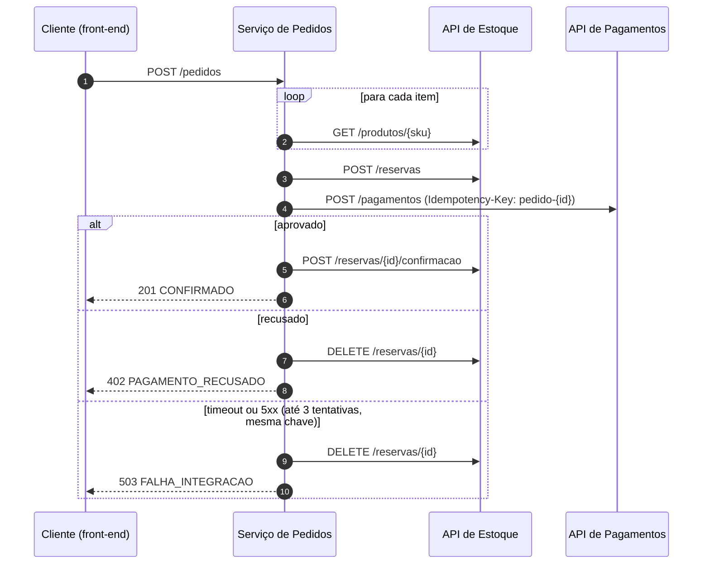

# Testes de integração com GenAI: checkout entre Pedidos, Estoque e Pagamentos

Atividade do fórum da Unidade III da disciplina **Testes de Software Automatizados com Inteligência Artificial
Generativa**: definir tipos de prompt para apoiar testes de integração, experimentar com uma LLM e registrar os casos
de teste gerados. Todos os dados são fictícios.

## Resumo

- **Cenário:** integração entre serviços REST, num checkout em que o serviço de Pedidos chama as APIs de Estoque e
  Pagamentos, com retentativa, `Idempotency-Key` e compensação.
- **Três tipos de prompt**, cada um em duas versões: cenários de integração, falhas de comunicação e contrato de API.
  Cada versão rodou no **Claude Sonnet 5.5** numa sessão nova, e as respostas estão guardadas sem edição.
- **Avaliação com régua objetiva:** compilação, execução, **10 defeitos de integração plantados** (quais suítes pegam
  cada um), diversidade dos cenários e leitura dos testes. Um **experimento extra** mediu se a LLM transforma em
  requisito um bug que já está no código.
- **A LLM achou três bugs reais**, que foram corrigidos (um deles introduzido por mim ao corrigir outro).
- **Suíte final:** 140 testes de integração montados a partir das respostas, todos passando e detectando
  os 10 defeitos plantados.

## O cenário de integração

Um serviço de **Pedidos** (Java 21 + Spring Boot 3.5) faz o checkout de uma loja integrando, via HTTP, duas APIs REST
de outros times: **Estoque** (preço, reserva, confirmação e liberação de itens) e **Pagamentos** (cobrança com
`Idempotency-Key`). Os contratos OpenAPI das duas APIs estão em [`contratos/`](contratos) e as regras de integração
(R1 a R12) em [`docs/regras-de-integracao.md`](docs/regras-de-integracao.md).



**Como os testes exercitam a integração.** São testes de integração "estreitos": o serviço de Pedidos sobe de verdade
(Spring Boot em porta aleatória, chamado por HTTP), e as APIs de Estoque e Pagamentos são simuladas com WireMock em
portas reais, respondendo conforme os contratos. Nada do serviço é mockado: controller, service, clients HTTP,
serialização JSON, timeouts e retentativas rodam como em produção. Isso permite provocar o que mais quebra integração
na vida real: timeout, conexão derrubada, 5xx, 4xx, resposta fora do contrato e resposta perdida depois de processada.
A infraestrutura comum está em [`IntegracaoBase`](src/test/java/com/estudo/checkout/suporte/IntegracaoBase.java).

## Os prompts

| Tipo | Para que serve | v1 | v2 |
|------|----------------|----|----|
| [1. Cenários de integração](prompts/1-cenarios-integracao) | Fluxos de negócio entre os três serviços | Zero-shot com papel e o código anexado | Escopo fechado, regras como fonte da verdade, infraestrutura fixa e matriz de rastreabilidade antes do código |
| [2. Falhas de comunicação](prompts/2-falhas-comunicacao) | Timeout, conexão derrubada, 5xx, 4xx, resposta fora do contrato, retentativa e compensação | Zero-shot com papel e o código anexado | Few-shot (um teste de exemplo), checklist de tipos de falha e regras e contratos como fonte da verdade |
| [3. Contrato de API](prompts/3-contrato-api) | O que o Pedidos envia e lê bate com o OpenAPI de cada provedor? | Zero-shot com papel, contratos e código anexados | Chain-of-thought (listar, comparar com o contrato e só então gerar), com o YAML como fonte única da verdade (escrita, mas não executada; ver resultados) |

Cada `v2.md` tem uma tabela "o que mudou e por quê", ligando cada ajuste ao problema que a v1 mostrou.

## Resultados

| Prompt | Versão | Testes gerados | Passam no código correto | Ajustes para rodar | Defeitos plantados detectados |
|--------|--------|---------------:|--------------------------|--------------------|:-----------------------------:|
| Cenários | v1 | 99 | 99 | nenhum | 10/10 |
| Cenários | v2 | 15 | 15 | nenhum | 6/10 (os 4 que escaparam são falhas de comunicação, fora do escopo dela) |
| Falhas | v1 | 64 | 16 antes do ajuste, 64 depois | 1 linha (bug de infraestrutura gerado pela LLM) | 10/10 |
| Falhas | v2 | 28 | 28 | nenhum | 9/10 (o que escapou é regra de negócio, fora do escopo dela) |
| Contrato | v1 | 78 | 76: os 2 que falhavam mostravam **bugs reais** | nenhum | 10/10 |
| Contrato | v2 | – | – | – | não rodou: a geração foi interrompida pelo filtro de segurança da ferramenta e não foi repetida |

**Experimento extra (o oráculo).** O prompt de falhas v1 e v2 rodou sobre uma cópia do código com dois bugs
plantados. Nenhuma versão transformou o bug em requisito. A v1 pegou os bugs por pistas no próprio código e por boa
prática, chamando um deles de "suspeita, pode ser intencional". A v2 apontou os dois como divergências das regras.
Detalhes em [`experimentos/oraculo/`](experimentos/oraculo).

**Bugs reais encontrados pela LLM:**

1. Com PIX, o `tokenCartao` do pedido era repassado ao Pagamentos, e o contrato proíbe (achado pelo prompt de
   contrato v1).
2. Pedido só com itens de preço 0 enviava `valorCentavos: 0`, abaixo do mínimo do Pagamentos: uma incompatibilidade
   entre os dois contratos (prompt de contrato v1).
3. `2 x Long.MAX_VALUE` estourava o total para negativo e o pedido era confirmado sem cobrança. Esse bug **eu
   introduzi** ao corrigir o item 2 (achado no experimento extra).

**O que mais fez diferença nos prompts:** mandar as regras e os contratos e dizer que eles valem mais que o código;
fixar a infraestrutura de teste (classe base pronta); restringir o que deixa o teste frágil ou lento (timeouts curtos,
só o prefixo das mensagens, nada de `Thread.sleep`); exigir stubs fiéis ao contrato; e delimitar o escopo de cada
prompt. A análise completa, com os limites do experimento, está em [`experimentos/README.md`](experimentos/README.md).

### Suíte final

A suíte final ([`src/test/java`](src/test/java/com/estudo/checkout)) junta o melhor das respostas, com a curadoria
anotada em cada classe:

| Pacote | Origem |
|--------|--------|
| `fluxos` | Prompt 1 v2 sem alterações, mais os casos de negócio que só a v1 trouxe (preço enviado pelo cliente é ignorado e variantes de validação de entrada) |
| `falhas` | Prompt 2 v2 sem alterações, mais os casos que só a v1 trouxe (corpo de erro ilegível, página HTML de proxy, chaves distintas por pedido, sem vazar detalhes internos, conexão recusada) e a regressão do estouro do total |
| `contrato` | Prompt 3 v1 sobre a infraestrutura comum, com as duas "lacunas" viradas testes de regressão |
| `suporte` | `IntegracaoBase`: serviço real em porta aleatória e WireMock estáticos para Estoque e Pagamentos |

## Estrutura do repositório

| Caminho | Conteúdo |
|---------|----------|
| [`src/main/java`](src/main/java/com/estudo/checkout) | Serviço de Pedidos (sistema sob teste) |
| [`contratos/`](contratos) | Contratos OpenAPI das APIs de Estoque e Pagamentos |
| [`docs/regras-de-integracao.md`](docs/regras-de-integracao.md) | Regras de integração R1 a R12 (a especificação) |
| [`prompts/`](prompts) | Os três tipos de prompt, versões v1 e v2, com o que mudou e por quê |
| [`experimentos/respostas/`](experimentos/respostas) | Respostas integrais da LLM, sem edição |
| [`experimentos/java/`](experimentos/java/com/estudo/checkout/experimentos) | Testes gerados em cada experimento, como vieram (ajustes anotados no arquivo) |
| [`experimentos/oraculo/`](experimentos/oraculo) | Experimento extra: o teste gerado pega o bug ou confirma o bug? |
| [`mutantes/`](mutantes) | Os 10 defeitos de integração plantados e o script de avaliação |
| [`src/test/java`](src/test/java/com/estudo/checkout) | Suíte final, montada a partir das respostas da LLM, com a curadoria anotada |

## Como executar

Requer JDK 21. O Maven vem pelo wrapper (`mvnw.cmd` no Windows, `./mvnw` no Linux/macOS).

```powershell
# suíte final
.\mvnw.cmd test

# suíte final + todos os testes gerados nos experimentos
.\mvnw.cmd test -Pexperimentos

# avaliação com os 10 defeitos plantados (cerca de 15 minutos; gera mutantes/resultado.md)
powershell -ExecutionPolicy Bypass -File mutantes\avaliar-mutantes.ps1

# experimento do oráculo (gera experimentos/oraculo/resultado.md)
powershell -ExecutionPolicy Bypass -File experimentos\oraculo\avaliar-oraculo.ps1
```

## Uso de IA neste trabalho

O projeto foi construído com apoio do Claude Code (Anthropic). Os casos de teste dos experimentos foram gerados pelo
**Claude Sonnet 5.5**, cada prompt numa sessão nova e sem acesso ao projeto, a partir dos textos em
[`prompts/`](prompts). A metodologia está em [`experimentos/README.md`](experimentos/README.md).
