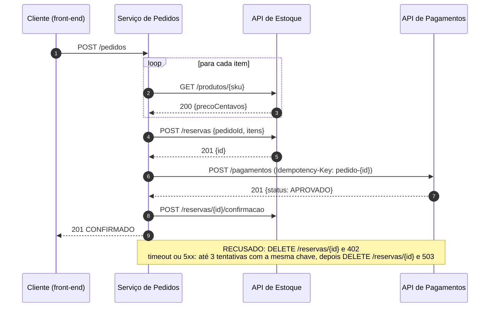

# Regras de integração do checkout

Especificação do que o serviço de Pedidos deve fazer em POST /pedidos ao conversar com as APIs de Estoque e
Pagamentos. Os contratos das duas APIs estão em [`contratos/`](../contratos).

| Regra | Descrição |
|-------|-----------|
| **R1** Validação de entrada | `clienteId` obrigatório; de 1 a 20 itens; `sku` não vazio; `quantidade` de 1 a 99; `metodoPagamento` PIX ou CARTAO; `tokenCartao` obrigatório quando CARTAO. Entrada inválida: **400** `DADOS_INVALIDOS`, sem nenhuma chamada ao Estoque ou ao Pagamentos e sem gravar pedido. |
| **R2** Preço vem do Estoque | Para cada item, `GET /produtos/{sku}`. Total = soma de `precoCentavos` x `quantidade`. O cliente não informa preço. |
| **R3** Produto inexistente | 404 do Estoque (na consulta ou na reserva): **422** `PRODUTO_INEXISTENTE`. Nada é reservado nem cobrado. |
| **R4** Reserva antes da cobrança | `POST /reservas` com o `pedidoId` e todos os itens. 409 do Estoque: **409** `SEM_ESTOQUE`, e o Pagamentos não é chamado. |
| **R5** Cobrança | `POST /pagamentos` com `valorCentavos` igual ao total do pedido, `metodo`, `tokenCartao` só quando CARTAO (com PIX o token é descartado) e o header `Idempotency-Key: pedido-{id do pedido}`. Pedido com total 0 (só itens gratuitos) não é cobrado, porque o Pagamentos exige `valorCentavos >= 1`: segue direto para a confirmação (R7). |
| **R6** Retentativa | Timeout, conexão recusada/resetada ou HTTP 5xx do Pagamentos: até **3 tentativas** no total, todas com a **mesma** Idempotency-Key. HTTP 4xx não é repetido. |
| **R7** Pagamento aprovado | Pagamento aprovado ou pedido com total 0: `POST /reservas/{id}/confirmacao` e **201** `CONFIRMADO`. |
| **R8** Pagamento recusado | Compensação: `DELETE /reservas/{id}`. **402** `PAGAMENTO_RECUSADO`, com o `motivo` informado pelo Pagamentos. |
| **R9** Pagamentos com falha | Indisponível depois das tentativas, resposta 4xx ou resposta fora do contrato (ex.: sem `id` ou `status`): `DELETE /reservas/{id}` e **503** `FALHA_INTEGRACAO`. Indisponibilidade nunca é tratada como recusa. |
| **R10** Estoque com falha | Timeout, falha de conexão, HTTP 5xx ou resposta fora do contrato (`precoCentavos` ausente, negativo ou com casa decimal; reserva sem `id`): **503** `FALHA_INTEGRACAO`, sem chamar o Pagamentos. A reserva não é repetida automaticamente (não é idempotente). |
| **R11** Falha depois da cobrança | Falha ao confirmar a reserva depois do pagamento aprovado: o pedido continua **201** `CONFIRMADO` (a pendência vai para o log). Falha ao liberar a reserva: o status do pedido não muda (a reserva expira sozinha no Estoque em 15 minutos). |
| **R12** Consulta | Todo pedido que passa pela validação é gravado com o status final e pode ser consultado em `GET /pedidos/{id}` (404 se não existir). O `motivo` de `FALHA_INTEGRACAO` começa com o nome do serviço (`estoque: ...` ou `pagamentos: ...`). |
